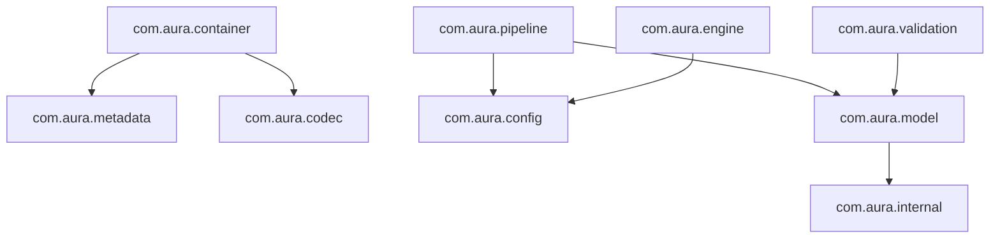

# Architecture Design Document

This document outlines the package layout, data flow, and design patterns used in the Aura Document Processor (ADP).

## Modular Package Layout

ADP is structured into distinct, decoupled packages under the `com.aura` namespace:



### Core Packages & Responsibilities

1.  **`com.aura.internal`**: Low-level helper utilities. Contains CRC32 checksum generators, argument assertions, and big/little-endian byte array conversions.
2.  **`com.aura.stream`**: Sequential streaming support. Bit-level streams, bounded streams (for zip bomb security), seekable buffer abstractions, and checksum verification wrappers.
3.  **`com.aura.codec`**: Compression and encryption codecs:
    *   `compression`: Run-length encoding (PackBits style) and sliding window LZ77 compression.
    *   `encryption`: Key permutations XOR cipher and JCE block cipher wraps.
4.  **`com.aura.metadata`**: Tag-Length-Value (TLV) Binary Structured Metadata (BSM) reader and writer.
5.  **`com.aura.config`**: Lexer and recursive descent parser for Xon Config Format (`.xcf`), as well as schema validators for range and regex checks.
6.  **`com.aura.model`**: Document AST tree structures (paragraphs, images, tables, scripts). Includes an expression evaluator for math scripts and path queries.
7.  **`com.aura.engine`**: Finite State Machines (FSM) containing transition guard conditions, event log replayers, and textual tag-based template formatting.
8.  **`com.aura.validation`**: Graph check managers running cycles DFS tests, integrity checks, and schema layout compliance rules.
9.  **`com.aura.pipeline`**: Process runners converting document nodes to HTML/Markdown and mapping Xon objects to layout nodes.

## Pipeline Data Flow

The core integration path combines text parsing, state evaluation, binary container packing, and HTML/Markdown rendering in a unified loop:

```
[Raw Xon Config (.xcf)]
         │
         ▼
    XonParser  ──► XonSchemaValidator
         │
         ▼
  FormatConverter
         │
         ▼
  [Document Graph] ──► ValidationEngine (Topological Cycle DFS check)
         │
         ▼
   TextExtractor / HTML / Markdown Rendering
```

## Security Boundaries & Sandboxing

A primary architectural driver is protection against malformed inputs:
*   **Buffer Bounds Checks**: All byte conversions explicitly check bounds and throw custom exception classes.
*   **Depth Constraints**: The XCF parser, template engine, and BSM decoder restrict maximum nesting recursion depth to prevent StackOverflow crashes.
*   **Allocation Limits**: Decoders check uncompressed sizes prior to allocations to block memory exhaustions (Denial of Service).
