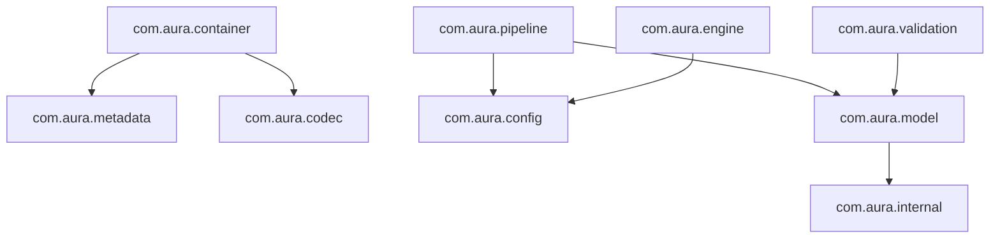

# Architecture Design Document

This document outlines the package layout, data flow, and design patterns used in the Aura Document Processor (ADP).

## Package Layout

ADP is structured into packages under the `com.aura` namespace:



### Core Packages & Responsibilities

1. **`com.aura.internal`**: Contains CRC32 checksum generators, argument assertions, string tokenizers, mathematical bounds clamping, and byte array conversion helpers.
2. **`com.aura.stream`**: Contains bit-level streams, bounded streams (to restrict read limits), seekable buffers, and checksumming streams.
3. **`com.aura.codec`**: Contains codecs for compression and encryption:
    - `compression`: Run-length encoding (PackBits style), sliding window LZ77 compression, and word-level dictionary compression.
    - `encryption`: XOR key permutations, key derivation functions, and JCE-based block cipher wrappers.
4. **`com.aura.metadata`**: Decodes and encodes Binary Structured Metadata (BSM) tag-length-value formats.
5. **`com.aura.config`**: Contains token lexers, recursive descent parsers, and validation schemas for Xon Config Format (`.xcf`).
6. **`com.aura.model`**: Defines document node types (paragraphs, images, tables, scripts), query path evaluation, and template expression evaluation.
7. **`com.aura.engine`**: Event stream log replayers, state transition engines, and document template engines.
8. **`com.aura.validation`**: Graph checkers running topological sorting cycle checks and integrity rules.
9. **`com.aura.pipeline`**: Layout paginators, CSS stylesheet mappers, format renderers (HTML and Markdown), and document node builders.

## Pipeline Data Flow

The processing pipeline connects configuration parsing, document tree generation, graph cycle checks, and rendering:

```
[Raw Xon Config (.xcf)]
         │
         ▼
    XonParser  ──► XonSchemaValidator
         │
         ▼
  FormatConverter
         │
         ▼
  [Document Graph] ──► ValidationEngine (Topological Cycle DFS check)
         │
         ▼
   TextExtractor / HTML / Markdown Rendering
```
